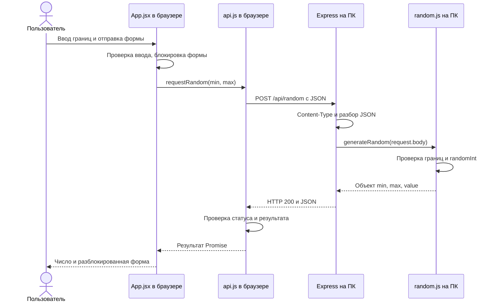

<!-- Учебный разбор написанных исходников. Это документация, не выполняемый код.
     Примеры описывают текущую реализацию; порядок запуска приведён в README.md.
     package.json объясняется здесь, поскольку стандарт JSON не допускает комментариев. -->
# Подробный разбор лабораторной № 1: генератор случайных чисел

Этот документ предназначен для изучения проекта и подготовки к защите. Он объясняет назначение технологий, ответственность файлов, последовательность работы и причины решений. Реализованы этапы 1–5; проверка на физическом телефоне с Авророй остаётся отдельной задачей. Документ не утверждает, что непроведённые проверки уже выполнены.

## 1. Что делает приложение и почему нужен сервер

Пользователь задаёт нижнюю и верхнюю границы, нажимает кнопку или Enter и получает случайное целое число. Диапазон включает обе границы. Разрешены отрицательные числа и ноль; одинаковые границы возвращают единственное число.

Задание требует серверное ПО, реализующее логику варианта. Поэтому число вычисляется в `server/random.js` на компьютере с Node.js. Браузер отображает форму, проверяет ввод для удобства пользователя и обращается к серверу. Сам React число не генерирует.

Например, при вводе 1 и 100 браузер отправляет два числа. Сервер может вернуть 42. Браузер отображает именно полученные данные. Если остановить сервер, форма продолжит отображаться в уже открытой вкладке, но новая генерация завершится ошибкой связи.

Ограничение ±1 000 000 000 — наше проектное решение, а не буквальное требование варианта. Целочисленный тип и включение обеих границ также зафиксированы нами, поскольку условие не уточняет эти детали.

## 2. Карта технологий: что, где и зачем

| Технология                        | Где работает                    | Роль в проекте                                                         |
| --------------------------------- | ------------------------------- | ---------------------------------------------------------------------- |
| HTML                              | Браузер                         | Оболочка страницы, контейнер React, язык, viewport                     |
| CSS                               | Браузер                         | Цвета, размеры, сетка, фокус, адаптация к ширине                       |
| JavaScript                        | Браузер и Node.js               | Язык клиентского и серверного кода, но в разных средах                 |
| React                             | Браузер                         | Отрисовка интерфейса в соответствии с текущим состоянием               |
| React DOM                         | Браузер                         | Подключение React к DOM через `createRoot`                             |
| JSX                               | Исходники клиента               | Удобное описание дерева интерфейса внутри JavaScript                   |
| Vite                              | Процесс разработки/сборки на ПК | Сервер разработки, обработка модулей и JSX, создание `dist`            |
| React-плагин Vite                 | Внутри Vite                     | Поддержка React-проекта и обновлений при разработке                    |
| Node.js                           | ПК-сервер                       | Исполнение JavaScript вне браузера, сетевой сервер и встроенные модули |
| Express                           | Внутри Node.js                  | HTTP-маршруты, middleware, статические файлы и ответы                  |
| `node:crypto`                     | Node.js                         | Встроенная генерация случайных целых чисел                             |
| HTTP                              | Между браузером и сервером      | Протокол запросов и ответов                                            |
| JSON                              | В телах HTTP-сообщений          | Формат передачи границ, результата и ошибок                            |
| `fetch`, Promise, `async/await`   | Клиент; также тесты в Node.js   | Асинхронное выполнение запросов                                        |
| `AbortController`                 | Клиент                          | Отмена ожидания зависшего запроса                                      |
| npm                               | Терминал на ПК                  | Установка зависимостей и запуск команд проекта                         |
| `node:test`, `node:assert/strict` | Node.js при тестировании        | Запуск проверок и утверждения об ожидаемых результатах                 |

React — библиотека интерфейса, Node.js — среда исполнения, Express — серверная библиотека, Vite — инструмент разработки. Они не заменяют друг друга. Express не исполняет React-компонент на сервере: он отдаёт готовые файлы, которые затем выполняет браузер.

DOM — представление HTML-документа в виде дерева объектов браузера. React управляет содержимым контейнера `root`; браузер применяет к получившимся элементам CSS.

## 3. Архитектура и границы ответственности



Сетевой модуль не знает о кнопках и CSS. Генератор не знает о HTTP. HTTP-приложение не решает, как отобразить ошибку. Такое разделение позволяет независимо тестировать части и менять транспорт без переписывания логики генератора.

Один React-компонент здесь достаточен: есть одна форма и один результат. Искусственное разделение каждой подписи на компонент не добавило бы пользы. Роутер, Redux и база данных для текущей задачи не нужны.

## 4. Разбор файлов и порядка загрузки

| Файл                                                 | Ответственность                              |
| ---------------------------------------------------- | -------------------------------------------- |
| [index.html](index.html)                             | Начальная HTML-страница                      |
| [src/main.jsx](src/main.jsx)                         | Монтирование React в HTML                    |
| [src/App.jsx](src/App.jsx)                           | Состояние формы, обработчики, JSX            |
| [src/api.js](src/api.js)                             | HTTP-запрос, чтение и проверка ответа        |
| [src/styles.css](src/styles.css)                     | Внешний вид и медиазапросы                   |
| [server/index.js](server/index.js)                   | Запуск процесса прослушивания порта          |
| [server/app.js](server/app.js)                       | Express-маршруты и обработка ошибок          |
| [server/random.js](server/random.js)                 | Проверки и генерация                         |
| [vite.config.js](vite.config.js)                     | Настройка разработки и сборки                |
| [package.json](package.json)                         | Команды, зависимости, требования Node.js     |
| [.gitignore](.gitignore)                             | Исключения Git                               |
| [tests/random.test.js](tests/random.test.js)         | Проверки генератора                          |
| [tests/api.test.js](tests/api.test.js)               | Проверки реального HTTP API                  |
| [tests/client-api.test.js](tests/client-api.test.js) | Проверки сетевого модуля клиента с подменами |
| [PLAN.md](PLAN.md)                                   | Требования, этапы и критерии завершения      |
| [README.md](README.md)                               | Инструкция запуска и фактические проверки    |
| [EXPLANATION.md](EXPLANATION.md)                     | Этот учебный разбор                          |

`package-lock.json` создаёт npm; он фиксирует точное дерево зависимостей. `node_modules` содержит установленные пакеты, `dist` — результат сборки. Эти файлы не комментируются и не редактируются вручную. Изменения в `dist` потеряются при следующей сборке.

## 5. HTML и точка входа React

`<!doctype html>` включает стандартный режим браузера. `lang="ru"` сообщает язык страницы. UTF-8 обеспечивает правильную кириллицу. `viewport` позволяет ширине страницы соответствовать мобильному экрану, иначе мобильный браузер может использовать широкую виртуальную область и уменьшать её целиком.

`<div id="root">` — место для приложения. Скрипт с `type="module"` указывает исходную точку входа `src/main.jsx`. Vite обрабатывает JSX и импорты; браузеру приходит исполняемый JavaScript, а не необработанный JSX.

В `main.jsx` функция `createRoot` связывает React с элементом `root`. Затем `render` отображает `<App />`. Имя компонента начинается с большой буквы, чтобы JSX отличал его от HTML-тега.

`React.StrictMode` включает дополнительные проверки разработки, в том числе повторные вызовы некоторых функций для обнаружения побочных эффектов. Это не означает автоматическую двойную отправку пользовательского обработчика формы. Запрос находится в `handleSubmit`, а не выполняется непосредственно при рендере.

Импорт `styles.css` обрабатывается сборщиком. В готовой сборке CSS подключается как ресурс страницы. Перезагрузка всего HTML-документа не требуется для показа нового числа.

## 6. App.jsx: состояние и события

### 6.1. Почему это функция

`App` — функциональный React-компонент. Его результат — JSX-описание нужного интерфейса. Когда состояние меняется, React снова вычисляет описание и обновляет соответствующие части DOM.

JSX похож на HTML, но находится внутри JavaScript: используются `className` вместо `class`, `htmlFor` вместо `for`, выражения в фигурных скобках и обработчики как функции. Запись `{result.value}` вставляет значение, а не строку с буквами «result.value».

### 6.2. Переменные состояния

| Переменная         | Начальное значение | Для чего нужна                                    |
| ------------------ | ------------------ | ------------------------------------------------- |
| `min`              | `'1'`              | Текст нижней границы                              |
| `max`              | `'100'`            | Текст верхней границы                             |
| `pending`          | `false`            | Выполняется ли запрос, нужно ли блокировать форму |
| `result`           | `null`             | Последний проверенный объект ответа               |
| `error`            | `''`               | Текст текущей ошибки                              |
| `inFlight.current` | `false`            | Немедленная защита от повторного submit           |

`useState` предоставляет значение и функцию обновления. Обновление применяется для следующего рендера; переменная в уже выполняющемся обработчике не меняется мгновенно. [Официальное описание useState](https://react.dev/reference/react/useState).

Поэтому для синхронной защиты используется `useRef`. Изменение `inFlight.current` видно сразу, но само по себе не инициирует рендер. `pending` нужен для видимой блокировки, ref — для защиты обработчика до следующего обновления DOM.

Строки в `min` и `max` позволяют представить пустое поле. Если преобразовывать любой ввод в число сразу, `Number('')` даст 0 и потеряется различие между отсутствием значения и реальным нулём. `type="number"` может нормализовать некорректный промежуточный ввод в пустую строку; клиент обрабатывает это как незаполненное поле.

### 6.3. Управляемые поля и changeValue

Поле получает `value` из состояния. `onChange` извлекает новое значение из `event.target.value` и вызывает обновление состояния. Это управляемое поле: отображение и данные связаны через React.

`changeValue` принимает нужную функцию обновления (`setMin` или `setMax`) и новое значение. Одновременно он очищает результат и ошибку. Иначе результат старого запроса мог бы выглядеть как число для уже изменённого диапазона.

### 6.4. handleSubmit по шагам

1. `preventDefault` отменяет стандартную навигацию HTML-формы.
2. Проверяется ref-защита: если запрос уже идёт, повторный submit игнорируется.
3. Очищаются прежние результат и ошибка.
4. Проверяется пустота строк через `trim`.
5. Строки преобразуются в числа через `Number`.
6. `Number.isInteger` отклоняет дроби, NaN и Infinity.
7. Модуль каждой границы сравнивается с пределом.
8. Проверяется порядок границ.
9. Устанавливаются ref и `pending`.
10. `await requestRandom` ожидает результат сетевого модуля.
11. Успех сохраняется в `result`, исключение — в `error`.
12. `finally` снимает обе блокировки независимо от исхода.

Ранние `return` после ошибки ввода не запускают сеть. `noValidate` отключает автоматические браузерные сообщения, чтобы использовать единые русские сообщения приложения. `required`, `step`, `min`, `max` сохраняют смысл и ограничения HTML-полей, но не заменяют ручную и серверную проверки.

### 6.5. Отрисовка и доступность

`fieldset disabled` блокирует всю группу, включая кнопку. `legend` задаёт название группы. `label htmlFor` связан с `id` поля. Клик по подписи фокусирует поле, а вспомогательные технологии получают его название.

Кнопка имеет `type="submit"`, поэтому кнопка и Enter используют один обработчик формы. Дополнительный обработчик Enter не нужен.

`aria-describedby` связывает поле с подсказкой и, при наличии, ошибкой. `role="alert"` обозначает появившееся важное сообщение. Область результата с `aria-live="polite"` просит объявлять изменение без прерывания текущей речи; `aria-atomic` просит читать область целиком. Фактическое поведение зависит от сочетания браузера и экранного диктора: проверка дерева доступности не равна прослушиванию диктором.

Вложенный тернарный оператор выбирает ожидание, результат либо начальную инструкцию. `<>...</>` — React-фрагмент без дополнительного элемента DOM. `<output>` семантически обозначает результат вычисления. React выводит сообщение ошибки как текст; HTML из сообщения не интерпретируется через `dangerouslySetInnerHTML`, которого здесь нет.

## 7. api.js: асинхронность, HTTP и ошибки

### 7.1. Promise и await

Promise представляет результат, который появится позже: успешное значение или причину отклонения. `async`-функция возвращает Promise. `await` приостанавливает продолжение конкретной функции до его завершения, не блокируя всю страницу. Поэтому браузер может отрисовать «Генерация…», пока сеть ждёт ответа.

Это не означает, что JavaScript автоматически создаёт отдельный поток для функции. Сетевым ожиданием занимается среда браузера, а продолжение функции выполняется после получения результата.

### 7.2. Содержимое запроса

```http
POST /api/random
Content-Type: application/json

{"min":1,"max":100}
```

`JSON.stringify` преобразует объект JavaScript в текст. JSON — формат данных, а не вызов функции. Сервер разбирает этот текст обратно в объект.

Адрес `/api/random` относительный: используется схема, хост и порт текущей страницы. Это позволяет открывать приложение с телефона по IP компьютера. Если написать в клиенте `http://localhost:3000`, на телефоне это указывало бы на сам телефон.

### 7.3. Почему проверки ответа многоступенчатые

Сначала может не установиться соединение: тогда `fetch` отклонит Promise, а объекта HTTP-ответа вообще не будет. Затем может не прочитаться JSON, например если вместо него пришла HTML-страница ошибки. После разбора нужно проверить `response.ok`: HTTP 400 или 500 сами по себе не означают отклонение Promise от `fetch`.

Для успешного статуса дополнительно проверяются `min`, `max` и `value`. Результат должен быть целым числом внутри именно отправленного диапазона. Даже статус 200 не защищает от ошибки реализации или неожиданного формата ответа.

`data?.error?.message` использует optional chaining: отсутствие промежуточного поля не вызывает ошибку обращения к свойству. Если сервер не прислал подходящего сообщения, создаётся запасной текст с HTTP-статусом.

### 7.4. Тайм-аут

При каждом вызове создаётся новый `AbortController`. Его `signal` передаётся в `fetch`, а `setTimeout` вызывает отмену через 10 000 мс. Таймер работает и во время чтения тела ответа.

Отмена распознаётся через `controller.signal.aborted` и превращается в русское сообщение. В `finally` вызывается `clearTimeout`, чтобы завершённому запросу больше не соответствовал активный таймер.

Отмена на клиенте не гарантирует прекращения обработки на сервере. Она ограничивает время ожидания пользователем. Для нашего быстрого генератора это не создаёт сохраняемых побочных эффектов.

## 8. Сервер: запуск и маршруты

### 8.1. server/index.js

`process.env.PORT` — настройка из окружения. Она поступает как строка и преобразуется через `Number`. Оператор `??` подставляет 3000, только если значение отсутствует, а не для любой ложной величины. Порт должен быть целым от 1 до 65535.

`app.listen` открывает сетевой порт. `0.0.0.0` разрешает прослушивание всех IPv4-интерфейсов. На телефоне вводится конкретный IP компьютера. Доступ дополнительно зависит от сети и брандмауэра.

Обработчик события `error` сообщает о проблемах запуска, например занятом порте. `process.exitCode = 1` обозначает неуспешное завершение для оболочки.

### 8.2. server/app.js и middleware

Middleware — функция, участвующая в обработке запроса. Она может завершить ответ, передать управление дальше через `next` или вызвать ошибку. Порядок регистрации имеет значение.

В нашем приложении последовательность следующая:

1. `GET /api/health` возвращает диагностический JSON.
2. `POST /api/random` проверяет тип содержимого.
3. `express.json` разбирает тело запроса с ограничением 1 КБ.
4. Обработчик вызывает генератор и возвращает результат.
5. Неизвестные адреса `/api` получают JSON 404.
6. `express.static` отдаёт файлы `dist`.
7. Специальный middleware переводит исключения в JSON-ошибки.

`strict: false` у JSON-парсера не означает отключение проверки. Парсер допускает любое синтаксически правильное JSON-значение, а генератор отдельно требует объект с числовыми полями. Так `null` и массив получают ошибку предметного формата, а повреждённый текст — `INVALID_JSON`.

`response.status(...).json(...)` задаёт HTTP-статус, сериализует объект и отправляет JSON. `return` после отправки отказа прекращает выполнение текущего обработчика. `Cache-Control: no-store` просит не сохранять успешный случайный ответ в HTTP-кеше.

### 8.3. Обработка исключений

Синхронное исключение из обработчика Express передаётся обработчику ошибок. Его сигнатура содержит четыре аргумента: `(error, request, response, next)`. Удаление неиспользуемого четвёртого аргумента изменило бы распознавание middleware. [Обработка ошибок Express](https://expressjs.com/en/guide/error-handling/).

| Статус | Код                      | Смысл                                             |
| ------ | ------------------------ | ------------------------------------------------- |
| 200    | Нет ошибки               | Генерация успешна                                 |
| 400    | `INVALID_RANGE`          | Тип, наличие, величина или порядок границ неверны |
| 400    | `INVALID_JSON`           | Текст не разбирается как JSON                     |
| 413    | `PAYLOAD_TOO_LARGE`      | Тело больше 1 КБ                                  |
| 415    | `UNSUPPORTED_MEDIA_TYPE` | Неподходящий тип содержимого либо кодировка       |
| 404    | `NOT_FOUND`              | Неизвестный маршрут API                           |
| 500    | `INTERNAL_ERROR`         | Непредвиденное исключение                         |

Формат ошибки: `{"error":{"code":"INVALID_RANGE","message":"..."}}`. Код предназначен для программной обработки, текст — для пользователя. Подробности непредвиденного сбоя записываются в серверную консоль, клиент получает общее сообщение.

### 8.4. Статические файлы

`new URL('../dist/', import.meta.url)` находит папку относительно серверного модуля. `fileURLToPath` превращает файловый URL в корректный путь ОС, включая пробелы и кириллицу. Поэтому путь не зависит от случайной текущей папки процесса.

`express.static` не собирает React. Он отдаёт уже созданные файлы. После изменения клиента нужно выполнить `npm.cmd run build`, иначе сервер продолжит отдавать старый `dist`.

## 9. random.js: проверка и генерация

Модуль экспортирует пределы, собственный класс ошибки и функцию `generateRandom`. Экспорт позволяет импортировать функцию в приложение и тесты.

Проверки идут от общего к частному:

1. Корневое значение должно быть объектом. `typeof null` тоже равен `'object'`, поэтому null исключается отдельно; массив также исключается.
2. Из объекта извлекаются `min` и `max`. Если поля нет, получается `undefined`.
3. `Number.isInteger` требует именно числовое целое значение. Строка `'1'` и логическое `false` не преобразуются автоматически.
4. Обе границы должны находиться в разрешённых пределах.
5. Минимум не должен превышать максимум.

`InvalidRangeError extends Error` создаёт различимый тип ошибки. HTTP-слой узнаёт его через `instanceof` и отвечает 400. Сам генератор ничего не знает о HTTP-статусах.

Для разных границ вызывается `randomInt(min, max + 1)`. У функции включён нижний предел и исключён верхний; прибавление единицы включает пользовательский максимум. Она избегает смещения, возникающего при неудачном приведении случайных значений к диапазону. [Документация randomInt](https://nodejs.org/api/crypto.html#cryptorandomintmin-max-callback).

Для 1–100 вызов использует пределы 1 и 101. Для −10…−1 — −10 и 0. При одинаковых границах выбирается само значение без случайной выборки.

Генерация синхронна: `generateRandom` сразу возвращает объект. Асинхронен клиентский сетевой сценарий, а не обязательно каждая функция сервера.

Повтор предыдущего результата не является ошибкой. Запрет повторов изменил бы распределение и потребовал хранения предыдущего значения, чего условие не требует.

## 10. Почему валидация повторяется на клиенте и сервере

Клиентская проверка нужна для удобства: показать ошибку сразу и не посылать заведомо неверный запрос. Серверная проверка нужна для корректности: любой человек может обратиться к API напрямую, минуя React.

Например, в PowerShell можно передать строку вместо числа. HTML-ограничения на такой запрос не действуют. Сервер обязан сам отклонить его.

Проверка ответа на клиенте решает третью задачу: не отображать результат, который не соответствует контракту API. Эти три проверки относятся к разным границам взаимодействия, а не являются случайным дублированием.

## 11. CSS: как устроена адаптация

### 11.1. Размеры и карточка

`box-sizing: border-box` включает рамку и внутренние отступы в заданную ширину. `max-width: 720px` ограничивает карточку на широком экране; `margin: 0 auto` центрирует её. Она может сжиматься вместе с доступным местом.

`rem` задаёт размер относительно шрифта корневого элемента. `em` относится к текущему размеру шрифта. Безразмерный `line-height` масштабируется вместе с текстом. Системный стек шрифтов позволяет работать без внешних загрузок.

### 11.2. Сетка и медиазапросы

`.range-fields` использует Grid и две колонки `minmax(0, 1fr)`. `1fr` — равная доля свободного пространства, нижний предел 0 позволяет колонке сжиматься. `min-width: 0` предотвращает растягивание сетки минимальной шириной содержимого.

При ширине до 600 px `@media` переключает сетку на одну колонку, уменьшает отступы и размер результата. При ширине до 360 px следующий блок дополнительно уменьшает размеры. На экране 320 px действуют оба блока; более позднее правило той же специфичности переопределяет предыдущее.

Медиазапрос смотрит на ширину viewport в CSS-пикселях. Это не определение марки телефона. Порядок элементов в DOM остаётся тем же, поэтому порядок Tab не меняется при перестроении колонок.

### 11.3. Ошибки, результат и фокус

`overflow-wrap` позволяет переносить длинное содержимое. `tabular-nums` просит шрифт использовать одинаковую ширину цифр. Высота элементов не менее 48 px облегчает касание.

`:hover:not(:disabled)` меняет кнопку только при доступном действии. Реально блокирует её HTML-атрибут, а CSS показывает состояние.

Для `:focus` задан заметный контур. Более точное правило с `:focus-visible` сохраняет его для клавиатуры, но может скрыть при клике мышью. Старый браузер без поддержки этого селектора сохраняет базовый контур.

Ошибка выделена текстом, рамкой и фоном. Пустой элемент ошибки остаётся в DOM с нулевыми отступами: при появлении сообщения обновляется уже существующая область объявления.

## 12. package.json — подробное объяснение без недопустимых комментариев

JSON требует строгого синтаксиса и не допускает `//` или `/* ... */`. Поэтому сам файл остаётся валидным, а каждое его поле объясняется здесь.

| Поле              | Значение и назначение                                                                        |
| ----------------- | -------------------------------------------------------------------------------------------- |
| `name`            | `lab-01-random-generator`: идентификатор проекта для npm                                     |
| `version`         | `0.1.0`: версия нашего приложения, не Node.js и не React                                     |
| `private`         | `true`: защита от случайной публикации пакета в npm                                          |
| `type`            | `module`: `.js` проекта используют ES modules с import/export                                |
| `engines.node`    | `>=24.13.0 <25`: заявленный поддерживаемый диапазон Node.js; поле само не устанавливает Node |
| `scripts`         | Именованные команды для `npm run`; start/test имеют короткие формы                           |
| `dependencies`    | Express, React, React DOM — зависимости приложения                                           |
| `devDependencies` | Vite и React-плагин — инструменты разработки и сборки                                        |

React после сборки входит в клиентский JavaScript; Express нужен серверу при запуске. На сервере готовой сборки Vite не работает, но для выполнения `build` он должен быть установлен.

### Команды

| Команда                  | Что реально выполняется                                               |
| ------------------------ | --------------------------------------------------------------------- |
| `npm.cmd run dev:client` | `vite`: клиентский сервер разработки                                  |
| `npm.cmd run dev:server` | `node --watch server/index.js`: сервер с перезапуском после изменений |
| `npm.cmd run build`      | `vite build`: создание готовых HTML/CSS/JS в `dist`                   |
| `npm.cmd start`          | `node server/index.js`: API и раздача сборки одним сервером           |
| `npm.cmd test`           | `node --test`: поиск и запуск тестовых файлов                         |
| `npm.cmd ci`             | Воспроизводимая установка по lock-файлу, не команда из scripts        |

`npm.cmd` используется в PowerShell, чтобы не зависеть от разрешения запуска `npm.ps1`. Глобально устанавливать React и Vite не нужно: npm-скрипты находят локальные исполняемые файлы зависимостей.

Точные версии прямых зависимостей записаны без `^` и `~`. Lock-файл фиксирует также транзитивные зависимости — пакеты, от которых зависят наши пакеты. Наличие lock-файла не является обещанием отсутствия уязвимостей на все будущие даты.

## 13. Два режима запуска и proxy

В разработке работают два процесса: Vite на 5173 и Express на 3000. Vite помогает быстро видеть изменения, а его proxy пересылает `/api` на Express. `strictPort: true` предотвращает незаметный переход Vite на другой порт при конфликте.

В режиме демонстрации сначала выполняется сборка, затем работает только Express на 3000. Он обслуживает и HTML/CSS/JS, и API. Настройки `server` в Vite к этому процессу не применяются.

Origin — сочетание схемы, хоста и порта. В обоих режимах браузер обращается к `/api` своего origin, поэтому отдельная настройка CORS в данном проекте не нужна. Proxy не является генератором — он пересылает запрос.

`localhost` и `127.0.0.1` указывают на устройство, где открыт браузер. Для телефона нужен IP компьютера в общей локальной сети. Внешний хостинг, домен и интернет после установки зависимостей не требуются.

`.gitignore` исключает установленные пакеты, сборку, журналы и локальные файлы окружения из нового отслеживания Git. Он ничего не удаляет с диска. Наличие `.env` в исключениях не означает, что сервер автоматически его читает: сейчас PORT берётся из окружения процесса.

## 14. Тесты: что они доказывают

### 14.1. Проверки генератора

`random.test.js` вызывает функцию непосредственно. Проверяет целочисленность, попадание в положительный, отрицательный, смешанный и полный диапазоны, одинаковые границы и неверные входы.

Сто выборок — проверка инварианта «каждое число внутри границ», а не доказательство равномерности. Нельзя требовать, чтобы за сто попыток обязательно встретился максимум или все числа были различны.

`assert.equal` проверяет строгое равенство, `deepEqual` — содержимое объекта, `ok` — истинность условия, `throws` — синхронное исключение нужного типа.

### 14.2. Проверки HTTP

`api.test.js` запускает реальный Express на порту 0: операционная система выбирает свободный порт. `before` ждёт запуска, `after` закрывает сервер. Поэтому тесты не требуют предварительного `npm start` и не занимают основной порт 3000.

Проверяются статус, Content-Type, JSON, код и текст ошибки, повреждённый JSON, размер тела и диагностика. Эти проверки покрывают интеграцию нескольких серверных частей.

### 14.3. Проверки клиентского запроса

`client-api.test.js` импортирует обычный JS-модуль без React. `t.mock.method` заменяет fetch и восстанавливает подмену после теста. Можно детерминированно вернуть ошибку сервера, HTML вместо JSON, неверный результат или имитировать отсутствие сети.

Виртуальные таймеры переводят время на 10 секунд без реального ожидания. Поддельный зависший fetch отклоняется при abort. `assert.rejects` проверяет отклонение Promise, в отличие от синхронного `assert.throws`.

Десять тестов — десять верхнеуровневых сценариев; внутри некоторых находятся таблицы множества случаев. Они не заменяют визуальную проверку, реальный экранный диктор или испытание на Авроре.

## 15. Мини-словарь синтаксиса из проекта

| Запись                      | Значение                                                                |
| --------------------------- | ----------------------------------------------------------------------- |
| `import` / `export`         | Подключение и предоставление модулей                                    |
| `const`                     | Запрет переназначения переменной, но не глубокая неизменяемость объекта |
| `let`                       | Переменная с возможностью переназначения                                |
| `{ min, max } = input`      | Извлечение свойств объекта                                              |
| `{ min, max, value }`       | Короткая запись свойств с совпадающими именами переменных               |
| `[value, setter]`           | Извлечение элементов массива, например результата useState              |
| `() => ...`                 | Стрелочная функция                                                      |
| `===`, `!==`                | Сравнения без неявного приведения типов                                 |
| `condition ? a : b`         | Выбор одного из двух выражений                                          |
| `?.`                        | Безопасное обращение при null/undefined                                 |
| `??`                        | Запасное значение только при null/undefined                             |
| `throw new Error(...)`      | Прерывание обычного пути выполнения исключением                         |
| `try/catch/finally`         | Выполнение, обработка исключения, обязательное завершение               |
| `async/await`               | Работа с Promise в последовательной форме                               |
| `1_000_000_000`, `1e9`      | Две записи одного числового значения                                    |
| `_request`                  | Соглашение об имени неиспользуемого аргумента, не специальный синтаксис |
| Шаблонная строка с `${...}` | Подстановка выражения в строку                                          |

## 16. Вопросы на защите и короткие ответы

**Где выполняется основная логика варианта?** В `server/random.js`, в процессе Node.js на сервере. React только запрашивает и показывает результат.

**Зачем React для такой простой формы?** Он связывает состояние ввода, ожидания, ошибки и результата с отображением. Для этой задачи можно было использовать обычный JavaScript; React выбран как разрешённый инструмент изучения клиентского интерфейса.

**Где асинхронность, требуемая заданием?** В `requestRandom` через fetch и await, а также в обработчике submit, ожидающем результат. Страница не перезагружается.

**Почему нельзя довериться min/max атрибутам input?** Прямой HTTP-запрос обходит HTML и React. Сервер обязан проверить данные сам.

**Почему две границы одинаковы — не ошибка?** Диапазон содержит ровно одно допустимое число.

**Почему к максимуму прибавляется 1?** API crypto.randomInt исключает верхнюю границу, а наш пользовательский диапазон её включает.

**Почему fetch не попал в catch при 400?** HTTP-ответ был получен успешно на транспортном уровне. Неуспешный HTTP-статус проверяется отдельно.

**Чем отличается 400 от 500?** 400 означает распознанную ошибку запроса, 500 — непредвиденный серверный сбой.

**Почему нет базы данных?** Результат вычисляется по текущему диапазону, сохранение истории не требуется.

**Зачем отдельные app.js и index.js?** Первый создаёт HTTP-приложение, второй запускает порт. Тесты используют приложение без запуска основного процесса на 3000.

**Где адаптивность?** В CSS Grid и `@media` на 600 и 360 px. На узком экране поля становятся одной колонкой.

**Как продемонстрировать реальное участие сервера?** Показать POST и JSON в Network, затем остановить сервер и повторить генерацию: появится ошибка связи.

**Что нужно телефону?** Браузер, связь с сетью ПК и адрес вида `http://IP-ПК:3000`. Устанавливать Node.js и React на телефон не нужно.

**Проверена ли Аврора?** Нет, пока не выполнено испытание на конкретном устройстве. Chrome с мобильной шириной подтверждает адаптивность, но не совместимость Авроры.

## 17. Как объяснить работу за несколько минут

1. Назвать тему, вариант и обязательность серверной логики.
2. Показать форму и выполнить генерацию.
3. В Network показать границы в запросе и число в ответе.
4. Открыть `App.jsx`: state, валидация и обработчик submit.
5. Открыть `api.js`: fetch, await, status и timeout.
6. Открыть `server/app.js`: маршрут и JSON-парсер.
7. Открыть `server/random.js`: проверки и включение максимума.
8. Показать CSS `@media` и узкую ширину браузера.
9. Запустить тесты и объяснить отличие модульных проверок от HTTP-проверок.
10. Объяснить запуск в локальной сети и отдельно обозначить статус проверки Авроры.

Для команд запуска и фактических результатов проверок используйте [README](README.md), для оставшихся задач — [план](PLAN.md).
