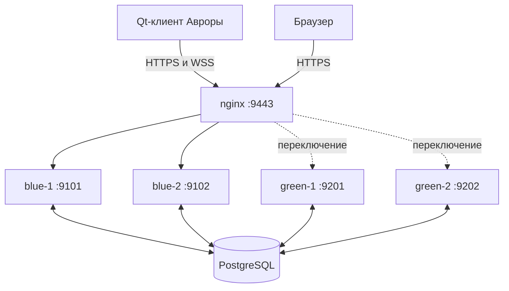

# Как работает третья лабораторная

## Что изменилось относительно второй

Во второй лабораторной один процесс FastAPI обслуживал все запросы. В третьей есть два рабочих процесса и nginx перед ними. Клиент знает только адрес nginx; выбор backend выполняет балансировщик.

SQLite на телефоне продолжает хранить кэш и offline-очередь. Сервер использует общую PostgreSQL. JWT-ключ и квитанции операций также общие: запрос не зависит от конкретного обслуживающего процесса.

## Как запрос попадает в нужный процесс

nginx принимает TLS-соединение и направляет запрос одному из upstream. Во внутренней сети ПК используется HTTP на loopback; backend не слушает внешние интерфейсы. Файлы `blue.conf` и `green.conf` содержат по два адреса. `active.conf` выбирает группу.

Для отказавшего адреса настроены `max_fails=1` и `fail_timeout=3s`. Это пассивная проверка: nginx узнаёт об отказе во время обращения. Отдельный `/ready` нужен скриптам развёртывания, чтобы проверить процесс до переключения трафика. Он не превращает nginx open source в активный health-checker.

В ответе backend добавляет `X-Backend-ID` и `X-App-Version`. Журнал nginx записывает фактически выбранный upstream. Это позволяет доказать, что запросы обслуживали разные процессы, а не просто показать два запущенных PID.

## Транзакции и параллельные запросы

Два backend могут одновременно получить повтор одного POST. Поэтому одной проверки «такого ключа ещё нет» недостаточно. Сервер получает транзакционную advisory-блокировку по владельцу и Idempotency-Key. Второй запрос ждёт COMMIT первого, затем читает его квитанцию.

Для изменений расход читается с `FOR UPDATE`. Проверка версии и запись выполняются под одной блокировкой строки: два PATCH с одной исходной версией не могут оба успешно затереть данные. Один получит 200, второй — 409 с актуальным состоянием.

Результат, квитанция операции и `pg_notify` находятся в одной транзакции. При ROLLBACK ни изменение, ни уведомление не становятся видимыми. Повтор уже выполненного запроса возвращает квитанцию и не генерирует второе событие.

## Почему push доходит между экземплярами

WebSocket закрепляется за одним процессом на всё время соединения. Запись пользователя при этом может изменить другой backend. Простой список сокетов в памяти одного процесса не обеспечивает межпроцессную доставку.

`PushHub` каждого процесса имеет отдельное PostgreSQL-соединение с `LISTEN expenses_changed`. Любая мутация вызывает `pg_notify`. Все процессы получают событие, фильтруют его по пользователю и отправляют своим подключённым клиентам. Поле владельца не отправляется в публичном JSON.

Очередь каждого сокета ограничена. При переполнении вместо накопления неограниченной памяти отправляется `resync`: клиент перечитывает REST-снимок. Если PostgreSQL-слушатель переподключился, всем его клиентам также предлагается синхронизация.

Push не является долговечным журналом доставки. После отсутствия сети события могли быть пропущены. Источник истины — PostgreSQL и REST API; уведомление означает «проверь актуальные данные». При каждом восстановлении WebSocket клиент выполняет REST-синхронизацию независимо от получения события.

## WebSocket на Авроре

`PushService` написан на C++. QML-движок и транспортный объект живут всю сессию; при смене контроллера отключаются callbacks и закрывается соединение, а не уничтожается сетевой QML-объект посреди SSL-обработки. Файл `services/PushSocket.qml` — небольшой транспортный адаптер штатного модуля QtWebSockets, а не экран. Он создаёт нативный WebSocket и передаёт текстовые кадры сервису. Сервис отвечает за JSON, дедупликацию, heartbeat, интервалы повторов и сигналы контроллеру.

JWT отправляется первым кадром внутри WSS. До проверки токена сервер не отправляет пользовательские события; на авторизацию отведено восемь секунд. Альтернативный способ для Python-тестов — Bearer-заголовок handshake. Токены не включаются в URL и access-log.

Сертификат добавляется в доверенные CA перед созданием сокета; проверка имени/SAN сохраняется. `ignoreSslErrors()` не используется. Для старого Qt транспорт Uvicorn выбран явно, с отключённым сжатием кадров. Версии Python-зависимостей зафиксированы.

Повторы: 1, 2, 4, 8, 16, затем 30 секунд. При успешном подключении интервал сбрасывается. Отсутствие heartbeat больше 35 секунд считается зависшим соединением. Offline-переключатель приостанавливает WSS и REST.

Если push приходит во время HTTP-синхронизации, контроллер запоминает `resyncRequested`. После завершения текущего действия выполняется дополнительная проверка. Это не позволяет потерять уведомление из-за занятого контроллера.

При разрушении контроллера callbacks отключаются до разрушения полей состояния. Сетевой сервис не посылает сигналы состояния из деструктора. Это существенно для Qt: QObject-соединения с лямбдами могут ещё существовать во время разрушения C++-членов объекта.

## Что делает systemd

`expenses@.service` — шаблон. `%i` заменяется именем инстанса, например `blue-1`. Его environment-файл задаёт порт, а путь `/opt/expenses-lab/instances/blue-1` указывает на отдельный снимок релиза.

`Restart=on-failure` перезапускает аварийно завершившийся процесс. Намеренная команда `systemctl stop` не считается аварией. `enable` создаёт привязку для запуска при загрузке ОС. `ProtectHome` и `ProtectSystem` ограничивают доступ службы; она исполняется от отдельного системного пользователя, не от root.

Секреты находятся в `/etc/expenses-lab/common.env` с ограниченными правами. Исходники релиза не содержат пароль БД или JWT-ключ. Общая БД и секреты не переключаются вместе с цветом группы.

## Blue-green

Релизы находятся в отдельных каталогах и не переписываются после публикации. `stage-release.sh` создаёт новый снимок и перезапускает процессы выбранной группы по одному. `switch-release.sh` проверяет оба новых `/ready`, меняет upstream, проверяет nginx и делает reload.

Green добавляет `/api/v1/summary`. Blue продолжает поддерживать прежний CRUD-контракт. Схема БД совместима с обеими версиями, поэтому откат не требует разрушительной миграции.

Reload nginx не переносит уже открытый WebSocket в другой процесс. Старый backend может завершить соединение при остановке, после чего клиент подключается заново через тот же адрес nginx. Демонстрация отдельно проверяет отсутствие HTTP-ошибок и восстановление push.

## Подпись и доказательства

mb2 вызывает rpmbuild по RPM spec. `tools/sign_package.sh` оборачивает штатный `rpmsign-external` установленного PSDK и выполняет verify. Самоподписанный TLS-сертификат сервера и сертификат подписи RPM имеют разные назначения.

`tests/test_cluster.py` проверяет настоящие nginx, PostgreSQL и два процесса. `exercise-cluster.py` действительно останавливает службы, переключает версии и сохраняет журнал запросов. Нативные тесты запускаются на телефоне и проверяют транспорт, SQLite, push и автоматическое обновление данных. Эти проверки не заменяют визуальную демонстрацию экрана пользователем.

Отказоустойчивость в этой работе относится к backend-процессам. PostgreSQL, nginx и сам ПК остаются общими точками отказа. Резервирование БД и нескольких физических узлов является отдельной задачей.

## Системные уведомления

При событии expense.changed WSS-сервис уже отфильтровал известные event_id. ExpenseController увеличивает счётчик и испускает expenseChanged(QVariantMap), после чего запускает обычную REST-синхронизацию. Отдельный QML-компонент qml/services/SystemNotification.qml слушает этот сигнал: транспорт не зависит от уведомлений ОС, контроллер не создаёт виджеты и не вызывает D-Bus напрямую.

Компонент выбирает заголовок для POST/PATCH/DELETE, задаёт summary/body для шторки и previewSummary/previewBody для баннера. publish() обращается к диспетчеру уведомлений; replacesId хранит полученный системный идентификатор. Повторная публикация с тем же ID заменяет запись. Временная метка соответствует моменту получения события, текст не утверждает завершения REST-запроса до его фактического окончания. Дополнительная защита хранит до 128 обработанных event_id; heartbeat, resync и статусы соединения сами по себе уведомлений не создают.

При полностью закрытом процессе нет WSS-соединения, следовательно, нет новых уведомлений. Это выбранный вариант работы при запущенном приложении, без отдельной фоновой службы. Настройки ОС определяют фактическую видимость preview; успешный ID публикации доказывает приём уведомления диспетчером, но сам по себе не доказывает показ баннера поверх экрана.
